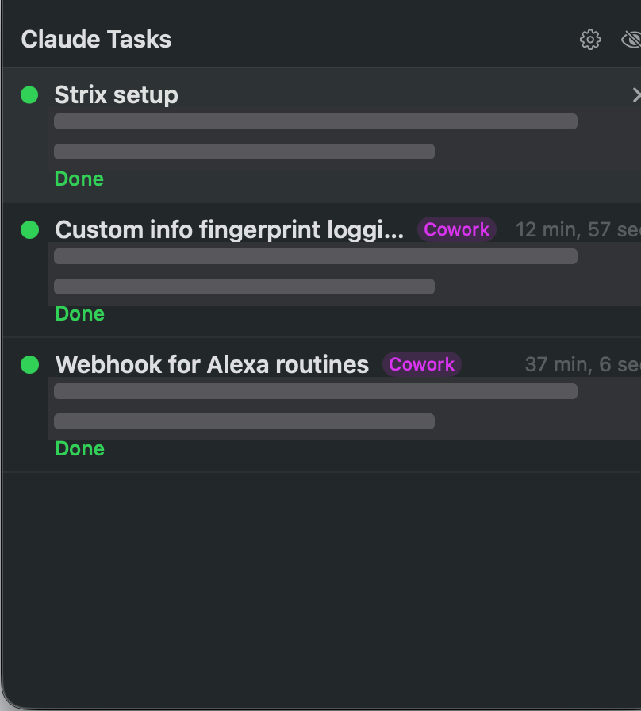

# Claude Task Monitor

**Never lose track of your AI tasks again.** A tiny menu-bar/tray app with an
always-on-top floating panel that shows the live status of every Claude Code and
Claude Cowork session on your machine — which ones are working, which need your
input, and which just finished. Native on **macOS**, with a **Windows** port.

[](https://www.paypal.com/paypalme/jschoes1994?locale.x=en_US&country.x=US)

*This is an independent open-source tool, not affiliated with or endorsed by Anthropic.*



---

## What it does

- 🔵 **Working…** — Claude is actively on it (pulsing dot), including background
  agents: "Working… · 2 agents running"
- 🟠 **Needs input** — a permission prompt or question is waiting on you
- 🟢 **Done** — finished and ready for your next message

Every row shows the session's title and the last thing Claude said.
**Click a row to jump straight there** — it focuses the exact Claude Desktop tab,
the Cowork session, or the exact Terminal/iTerm tab hosting a CLI session.

Use it your way:
- **Floating panel** — always on top, draggable, glanceable
- **Menu bar** — left-click the sparkle icon for a popover with the same feed;
  badges show `●N` sessions needing input and `✓N` finished since you last looked
- Or both. Pick in **⚙ Settings**, along with a text-size slider.

Feed control: hover **✕** dismisses a row until that chat is active again;
right-click → **Hide Chat** removes it persistently (the eye icon reveals hidden
chats so you can bring them back).

## Requirements

- macOS 13+ **or** Windows 10/11
- [Claude Code](https://claude.com/claude-code) — CLI and/or Claude Desktop

## Install (macOS)

1. Download the latest `Claude-Task-Monitor.zip` from
   [Releases](../../releases), unzip, and drag **Claude Task Monitor.app** to
   `/Applications`.
2. First launch: **right-click the app → Open → Open**. (The app is not notarized
   yet, so macOS warns once.)
3. Accept the offer to install **precise status hooks** (recommended, see below) —
   or skip it and turn them on later from the menu-bar icon.

## Install (Windows) — beta

The Windows port lives in [`windows/`](windows/) and covers the core features:
the always-on-top panel, tray icon with status tooltip, precise status hooks
(installed as a PowerShell script), background-agent counts, and click-to-open
via `claude://` links into Claude Desktop.

Build it with the [.NET 8 SDK](https://dotnet.microsoft.com/download):

```powershell
cd windows
dotnet publish -c Release -r win-x64
# → bin\Release\net8.0-windows\win-x64\publish\ClaudeTaskMonitor.exe
```

Install hooks from the tray menu, or scriptably:

```powershell
ClaudeTaskMonitor.exe --install-hooks
```

Not yet on Windows: AI titles, terminal-tab focusing, hide/dismiss, and the
settings window. **Beta** — built against the same file formats as the macOS
app but less battle-tested; issues welcome.

## Precise status hooks (optional, recommended)

Without hooks the app infers status from transcript activity, which is good but
can't always tell a permission prompt from a long-running command. With hooks,
Claude Code itself reports every state change the moment it happens — including
background agents starting and finishing.

Installing (from the first-launch prompt, the menu-bar menu, or Settings) does
exactly this, all reversible from the same menu:

- writes a small script to `~/.claude/task-monitor-hook.sh`
- adds hook entries to `~/.claude/settings.json` (your existing settings are
  preserved; removal deletes only these entries)
- status events land in `~/.claude/task-monitor/` as tiny JSON files

All hooks run async — zero added latency to your Claude sessions.

Scriptable, for dotfiles or fleet setup:

```bash
"/Applications/Claude Task Monitor.app/Contents/MacOS/ClaudeTaskMonitor" --install-hooks
"/Applications/Claude Task Monitor.app/Contents/MacOS/ClaudeTaskMonitor" --uninstall-hooks
```

## Stream Deck plugin

The [`streamdeck/`](streamdeck/) folder contains an Elgato Stream Deck plugin:
each key shows one session with a color-coded status (blue working, orange
needs input, green done, plus running agent counts), and pressing a key jumps
to that session in Claude Desktop.

Two ways to bind a key, chosen in the key's settings panel:

- **Auto slots** show your most urgent sessions, ranked needs-input first,
  then working, then most recent. Put auto slots 1 through 4 on a row and the
  hottest chats always surface there.
- **Pin a specific chat** to a key; it turns gray once that chat has been
  inactive for 8+ hours. Add and remove keys like any Stream Deck action.

Install on macOS (requires [Node.js](https://nodejs.org) and the Stream Deck
app 6.4+):

```bash
cd streamdeck && ./install.sh
```

On Windows: run `npm install` inside
`streamdeck/com.jamesschuler.claude-tasks.sdPlugin`, copy that folder to
`%APPDATA%\Elgato\StreamDeck\Plugins\`, and restart the Stream Deck app.

The plugin reads the same local files as the desktop app, so the precise
status hooks benefit it too. Test the scanner without a Stream Deck:

```bash
node streamdeck/com.jamesschuler.claude-tasks.sdPlugin/bin/plugin.js --scan-test
```

## AI titles for terminal sessions

Terminal sessions get a short AI-generated title (e.g. "Fix auth token refresh")
derived from their first prompt — powered by your own `claude` CLI in print mode
with Haiku. One tiny call per session, cached forever, no API key needed. Requires
the CLI to be logged in (`claude login`). Toggle it in Settings.

## Privacy

Everything stays on your Mac. The app reads Claude's local transcript and metadata
files, and writes only to `~/.claude/task-monitor/`, `~/.claude/settings.json`
(hooks, opt-in), and its own preferences. No analytics, no network calls — the
only network activity is the optional AI-title call made through your own
`claude` CLI.

## What it can and can't track

| Surface | Tracked? |
|---|---|
| Claude Code in Claude Desktop tabs | ✅ click focuses the exact tab |
| Claude Code in a terminal (any terminal app) | ✅ click focuses the exact Terminal/iTerm tab |
| Claude Cowork agent sessions | ✅ purple badge, click opens the session |
| Background agents inside a session | ✅ counted live via hooks |
| Regular claude.ai chats | ❌ state lives server-side; nothing exists locally to read |

## Build from source

```bash
git clone <this repo>
cd ClaudeTaskMonitor
./build.sh
open "build/Claude Task Monitor.app"
```

Requires Xcode command line tools (`swiftc`). No dependencies — one Swift file.

## Uninstall

1. Menu-bar icon (right-click) → **Disable Precise Status Hooks…**
2. Delete the app and `~/.claude/task-monitor/`.

## Known limitations

- **Regular claude.ai chats are not tracked** — unlike Claude Code and Cowork,
  ordinary Claude chats keep their conversation state on Anthropic's servers, so
  there is nothing on your Mac for the app to watch. Only Code and Cowork
  sessions appear in the feed.
- Built against Claude Desktop/CLI internals as of mid-2026 (transcript format,
  metadata locations, deep-link routes). Anthropic updates can break features
  until this app is patched — [open an issue](../../issues) if something stops
  working after a Claude update.
- Terminal tab selection asks for Automation permission on first click (macOS
  prompt); declining falls back to just fronting the terminal app.

## Support

If this app saves you from alt-tabbing all day, consider
[**buying me a coffee ☕ (PayPal)**](https://www.paypal.com/paypalme/jschoes1994?locale.x=en_US&country.x=US) —
it funds the patching whenever Claude's internals change.

## License

MIT

<!-- handoff:start -->
## Handoff

_Last updated 2026-11-01 by Claude Code. Full chat transcripts live in `chat-logs/`; the newest is the one to read first._

**Where things stand**

Added Elgato Stream Deck plugin (streamdeck/): one key per Claude session with color-coded status and press-to-open; auto slots rank most urgent first, or pin specific chats. Scanner validated against live data on this Mac; still needs an on-device test with the Stream Deck app, which is not installed here. Next step: run streamdeck/install.sh on the machine with the Stream Deck and verify keys render and presses open sessions.

**Pick this up on another machine**

```bash
gh repo clone jschoes1994/claude-task-monitor && cd ClaudeTaskMonitor
```

Then start Claude Code in the folder and say: "Read README.md and the newest file in chat-logs/, then continue where we left off."

**Chat logs (newest first)**

- [chat-logs/2026-11-01-f2491c1e.md](chat-logs/2026-11-01-f2491c1e.md)
<!-- handoff:end -->
